# Bioevolution

A modern take on the 1990s *Primordial Life* screensaver. It's an artificial-life petri dish that runs in the browser. Creatures are made of coloured lines with organs at their joints. They drift around, graze, hunt, breed and mutate, and over time the population evolves.

| Graphs | Species by place in the food chain |
|---|---|
| 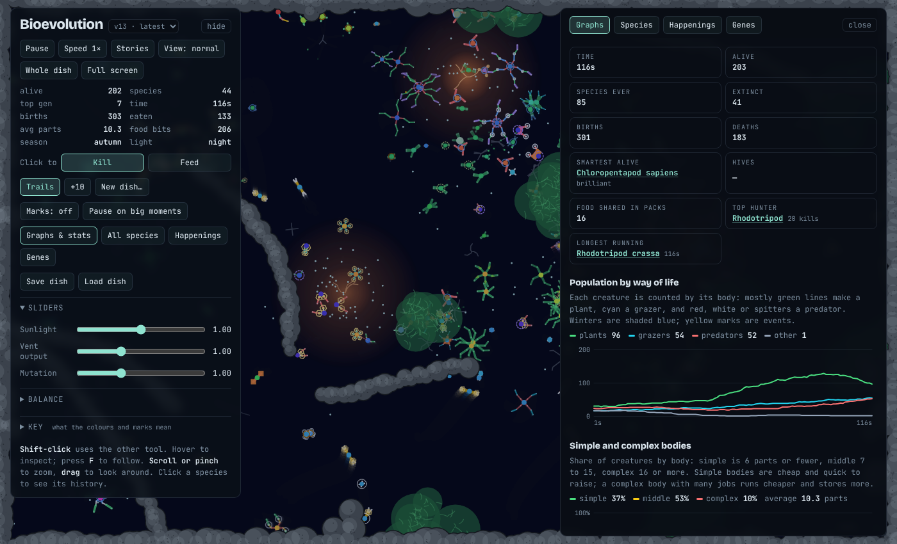 | 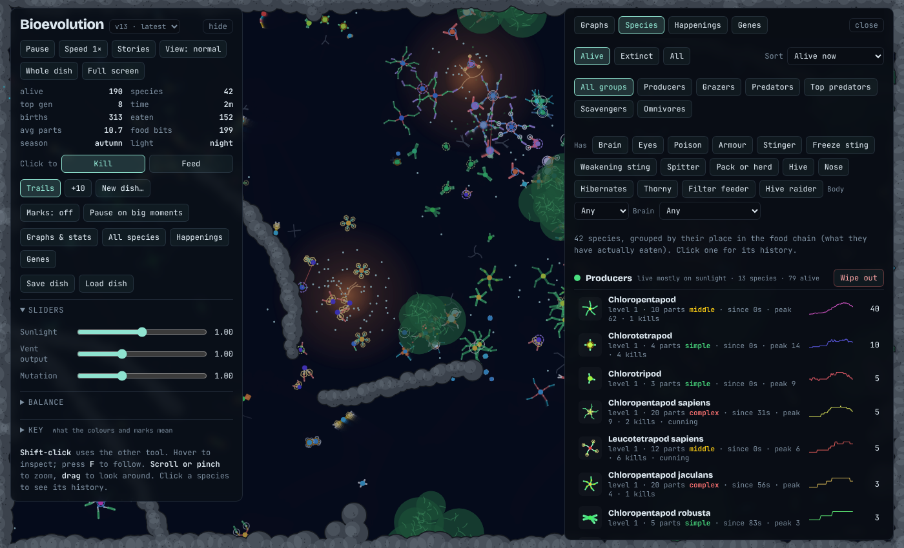 |

| A species page | New dish |
|---|---|
| 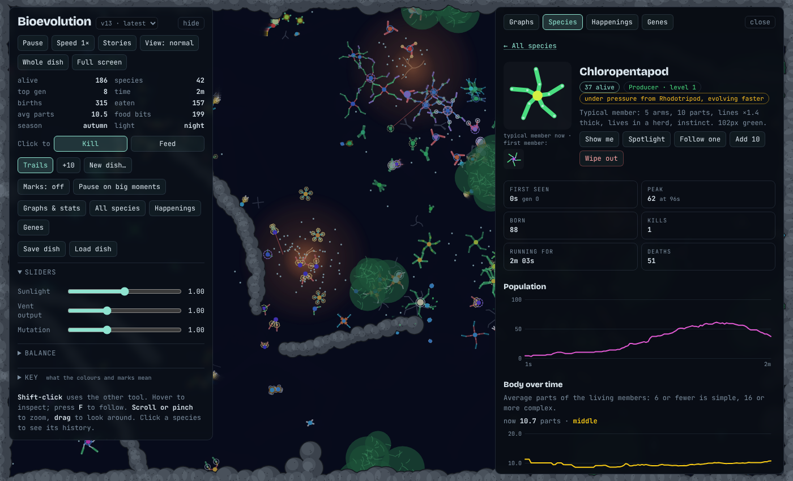 | 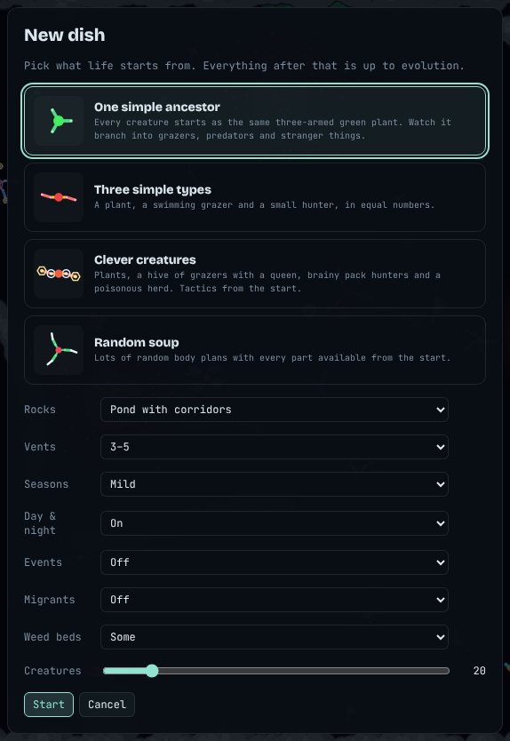 |

| Family tree | What a species inherited |
|---|---|
| 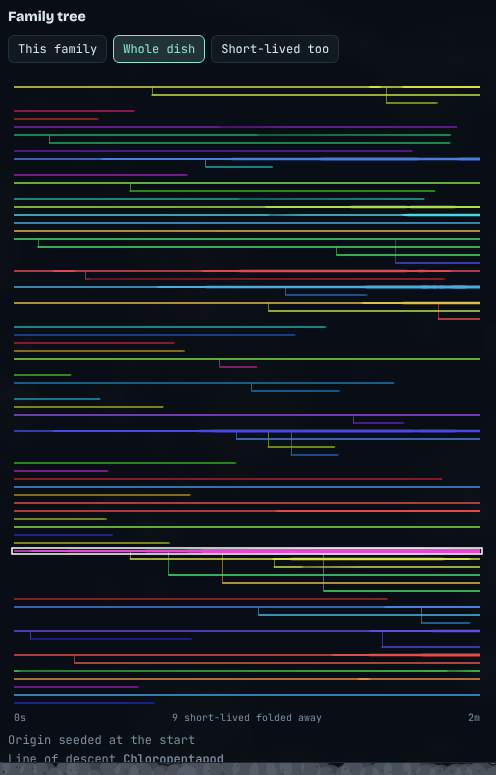 | 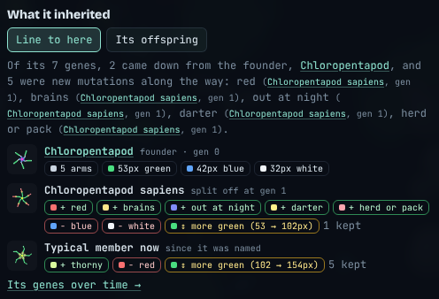 |

| Happenings | Genes |
|---|---|
| 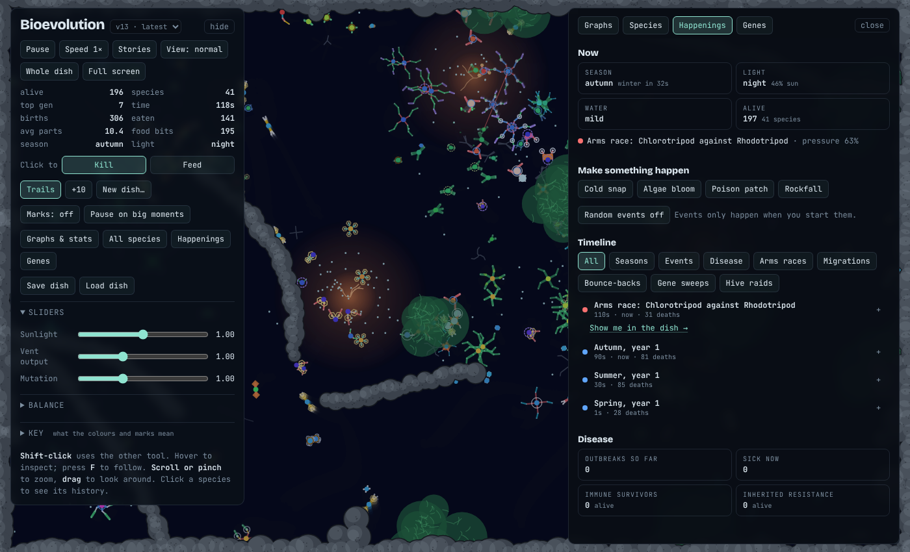 | 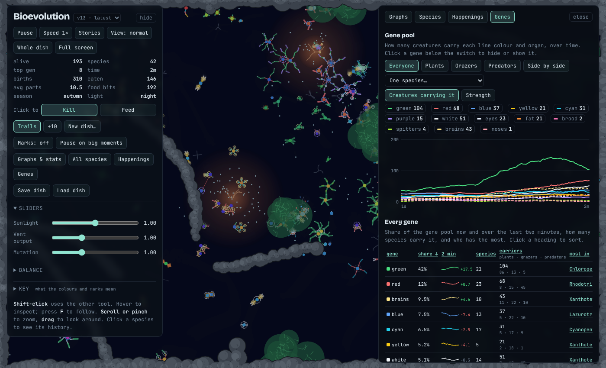 |

| Story mode | Ways of life view |
|---|---|
| 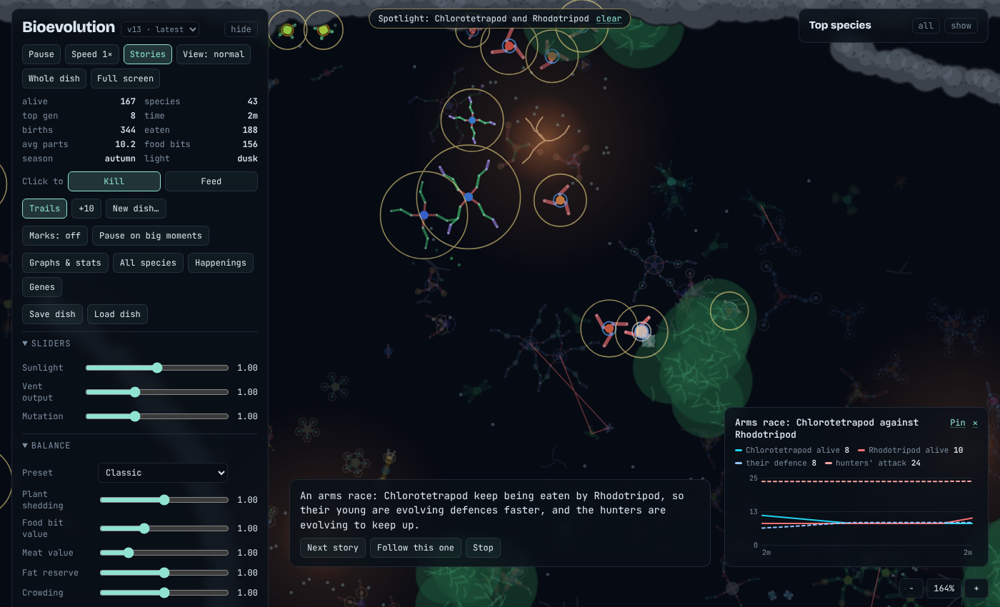 | 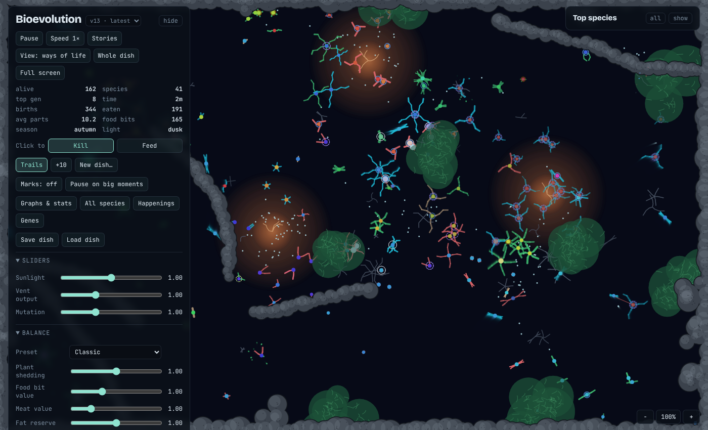 |

| Balance controls | Close-up |
|---|---|
| 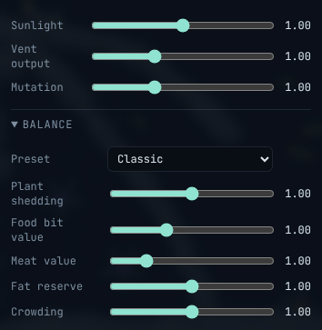 |  |

| On a phone |
|---|
|  |

## Run it

Open `index.html` in any modern browser. There is no build step and nothing to install.

## Body parts

**Lines: the colour is the job**

| Colour | Job |
|---|---|
| Green | Makes energy from sunlight and sheds some of it as food bits from its arm tips. Sunlight is shared, and close green neighbours shade each other, so a crowded patch feeds each plant less. |
| Cyan | Gathers food bits it touches and nibbles living plants. (Filter feeders, below, are the other way to graze.) |
| Red | Bites, draining energy from live creatures it crosses (unless it hits blue) and from corpses. |
| Blue | Armour. Blocks red bites, hurts the biter and pushes it away, and toughens the whole body (up to half off every bite). Cheap to run but heavy. A blue rim marks well-armoured creatures. |
| Yellow | Swims. Fast movement, at a small extra energy cost. An animal's other lines only wriggle it along slowly when cruising, and give no help in a chase or an escape, so yellow is the real sprint. A darter with yellow darts half as fast again. |
| Purple | Poison. A red segment that bites it poisons its owner, who loses energy for a few seconds. Hunters with eyes avoid poisonous prey, and a pack hunter that gets poisoned teaches its packmates nearby to leave that species alone. |
| White | Stinger. Freezes whatever it touches and drains energy, and while frozen the victim takes extra damage from every attacker. Each lineage evolves its own sting along an inherited venom gene: a **freeze sting** holds prey up to 4 seconds (good for packs), a **weakening sting** freezes for 1.5 seconds but leaves the prey taking up to 80% more damage (good for fast lone hunters), and most sit in between. A stinger can take prey half again its own size. Only blue armour stops it; poison doesn't. A hunter stung by the prey it was after backs off and leaves that kind alone for a while, so white is a defence for grazers too. |

**Organs: the shape is the job.** Organs sit at the end of a segment.

| Shape | Job |
|---|---|
| Circle (eye) | Sight. Lets the creature steer: flee dangerous predators, hunt weaker prey, head for food bits or corpses when hungry, and find a mate. More eyes see further. Eyes have a level, 1 to 3, from their total size, and each level sees a fifth further again; level 3 eyes also see well at night. Resting eyes cost less to run. A hunter whose eyes outrank its prey's sees through camouflage more easily, is fooled less by a herd and bites harder; prey whose eyes match or beat the hunter's spots it in time to get a head start. |
| Square (fat store) | Holds extra energy and a bigger fat reserve, and that fat burns half as fast in the cold, but adds mass, so the creature is slower. |
| Triangle (brood sac) | Lowers the energy needed to breed and gives a chance of twins, much more so when the dish has thinned out after a winter or a die-off. |
| Kite (spitter) | Shoots globs at the prey its owner is chasing, from up to 240px away. A hit drains energy from a distance and slows the target for 2 seconds; a stung target hit by spit stays slowed longer, and a slowed target that gets stung stays frozen longer. A herd or a hive can't shield its members from spit; blue armour softens it. |
| Two dots (nose) | Smell. Works even better at night, finds things in the weeds and smells corpses from further off, but only roughly. Cheaper than an eye. |
| Hexagon (brain) | Intelligence. Unlocks smarter moves (see *Brains* below). Costs upkeep and weight, and brainy parents need more energy to breed. |

## Rules

- **Size is strength.** Each line has a thickness and each organ a size, inherited and mutated like everything else. Thicker and bigger work harder (more sun, faster swimming, harder bites, longer sight) but cost more upkeep and weigh more. A weapon much thicker than the armour it hits breaks through.

- **Complexity costs.** Every part has upkeep, and upkeep grows faster than the part count, so a big complex body has to earn its keep. In return, complex creatures live longer and can do more.
- **Simple bodies have their own edge.** A body of 6 parts or fewer grows up sooner, its young cost less to make, hunters notice it a little closer in, and it feels the cold and catches disease less. The edge fades out by 10 parts.
- **Complex bodies have many jobs.** A body of 12 or more parts using 4 or more line colours runs 15% cheaper and stores 15% more energy, so it can ride out lean seasons. A species left alone by hunters for three minutes slowly sheds parts it no longer needs. The Graphs tab shows simple, middle and complex bodies over time, the species list tags each species by body type, and each species page charts its part count.
- **Food.** Every food bit has a source: plants shed them, glowing vents on the floor puff them out over a wide warm patch, and corpses rot into them. Bits drift, slide along rocks and rot away after a minute or so. Cyan segments gather them, and can smell them close by even without eyes; any creature can swallow one with its nucleus for half value. Cyan also **nibbles living plants** a little at a time, leaving them enough to grow back. Dead bodies stay as corpses for 60 seconds that red-biters can scavenge. A kill leaves almost half the body behind, so scavengers can follow the hunters. A new dish has 3 to 5 vents that share the same total output. Grazers are born knowing where the vents are, and head for one when they're under half full and see no food.
- **Scavengers.** A red-biter that lives mostly on corpses (or was born to scavengers and hasn't taken to hunting) is a carrion specialist: it digests the dead 30% better and pays 20% less upkeep while drifting. Corpses smell strong: a scavenger, or any biter that has eaten carrion before, smells one from about 300px (further with a nose), and fresh, big corpses and ones already being eaten pull hardest. With nothing to eat, a scavenger trails a hunter of another kind at a distance and moves in when it makes a kill.
- **Fat.** Sunlight gives the least energy, food bits more, and meat the most. Meat and carrion can overfill a creature into a fat reserve (shown in the inspector) that pays its upkeep first, so a well-fed hunter can wait out a lean spell.
- **Mixed diets cost.** A body built for one diet digests it fully. A creature that feeds several ways (say a plant with a red tip) digests each food worse the less of its body is built for it, so a plant gets little from the odd bite of meat. A brain halves the waste, so clever omnivores do best. Plant tissue is poor food for a meat-eater, and a body full of weapons is rich, so hunting grazers pays better than eating plants and hunting other hunters can pay too. The inspector shows how well a mixed feeder digests each food.
- **Plants live long.** Plants live three times as long as animals of the same build, so they rarely die of old age: they die from being eaten, shade or the cold.
- **Breeding.** Close relatives breed when they touch and are well fed, mixing both genomes. Very well fed creatures can also bud on their own.
- **Mutation.** Segment length, angle, colour and organ drift; segments and arms are added or removed; the nucleus colour drifts so lineages diverge.
- **You are what you eat.** A predator can keep genes from what it kills and pass them to its children.
- **Arms races.** Every 10 seconds each species gets a pressure score: how much of it was eaten (or nibbled) in the last minute, more if one hunter species does most of the damage. The young of a species under pressure mutate up to twice as much, and their changes lean to defence: armour, speed, camouflage, poison, eyes or a brain for animals; thorns, tough stems, poison or armour for plants. Hunters and grazers that are going hungry push back the same way, towards bite, speed, eyes and brains (or a tough mouth for grazers). Both ease off as soon as things calm down, and once a species is left alone its young now and then shed a part or organ they no longer need, so bodies can drift back to simple. A heavily hunted species starts an **arms race** in Happenings.
- **Thorns.** A thorny plant (dotted pale ring) pricks any grazer that nibbles it and loses less to the bite. A grazer with a tough mouth ignores thorns, and a clever one remembers which plants prick.
- **Helping grazers.** When grazers fall under a fifth of all creatures there's room for them: their young cost the parents less and come sooner. Old plants drop extra food bits as leaf litter. A grazer that only grazes digests a tenth better. A clever grazer that sees a hunter calls out, and its kind nearby run even if they can't see the hunter. A hunter chasing one of a herd of five or more can lose it in the crowd (stragglers and the starving excepted). Hunters without a brain stop hunting once they're 60% full; clever ones keep going and bank a surplus.
- **Bounce back.** If an event or outbreak cuts the dish by 40%, the survivors mutate faster for a minute and a half, so a burst of new species follows.
- **Predators hunt.** Anything with red, white or a spitter can smell prey close by even without eyes, lock on to a target, lunge with extra speed while chasing, and hunt whenever they're not full. After a kill they rest a moment to digest. They prefer whatever prey is plentiful, so rare species get a chance to recover. Predators breed more slowly than the creatures they eat and hold territories: one with several other predators close by won't breed. A faint red line shows who is chasing whom.
- **Packs and herds.** Every creature has a sociality gene. Loners keep to themselves. Social hunters gang up on whatever a close relative (family) is chasing and bite harder for each packmate nearby, so a pack can take prey too big for any one of them. Clever pack hunters with food to spare take some to a starving packmate, but leave the old to fend for themselves. Social prey herd with their family, keeping a little personal space, and each neighbour in the herd makes them harder to bite, sting or spit at, so a predator thinks twice before attacking a crowd. Being social costs a little upkeep.
- **Easy prey.** Newborns and the old take more damage and their armour counts for less, so hunters pick them out first, along with the starving and stragglers at the edge of a herd. Herds move off from any hunter they can see and bolt together, but hungry, young and old creatures can't run as fast and fall behind.
- **Brains.** Intelligence runs from instinct (0) to 3. Hunting tactics unlock in steps: aim ahead at 0.5, ambush at 0.75 (for slow or camouflaged hunters), flank a packmate's prey at 1, drive prey into a packmate or rock at 1.25, and at 1.5 armed herds mob a lone hunter. A kill made with a tactic bites 30% harder. Clever hunters (1+) stash a kill and come back to it. Clever prey hide as soon as they spot a hunter, flee the way that avoids every threat and the rocks, and bunch up as a herd; poisonous herd members shield the rest. A brain also remembers which species hurt it and where food was, and sees through mimics and lures. Small and middling brains are cheap; big ones cost much more.
- **Migration.** The dish is split into a 4 by 3 grid. A clever grazer (brain 1 or more) that is under half full in a poor part of the dish sets off for a better one, and its herd goes with it. Hunters don't migrate: in tests, hunters following the grazers around wiped the grazers out. Cunning grazers also steer well clear of parts with hunters in them. Brilliant animals know the whole dish and pick the best part; cunning ones pick the best part next door; clever ones any better part next door. On the way they swim a little faster and only stop to feed if they get hungry.
- **Loners.** A hunter that lives alone keeps its own patch: it chases off weaker hunters, keeps clear of stronger ones and heads home when idle.
- **Hives.** Rare but real. A new queen starts with a stocked nest, her first four workers hatch quickly and bigger than usual, and she is hard to hurt for her first minute. The hive gene now and then jumps high in a newborn, and with a clever brain (0.5 or more) that creature can become a queen (ringed), one per species in an area. She settles into a nest in the weeds or by a rock. The hive gene costs upkeep. Her eggs hatch as small sterile workers that bring food home; armed workers guard her. Workers pay 10% less upkeep. Plant hives are harder: founding one needs brain 1, their workers get no upkeep discount, and sunlight carries badly, so less than half of what they bring home reaches the queen. She feeds hungry workers from the hive's store and now and then lays a young queen who leaves to found a new hive. A big hive is hard to run: past 10 workers she lays more slowly.
- **Hive raiders.** An inherited hunter instinct that turns up more often while hives are common. A raider smells a queen from 300px away (the bigger the hive, the stronger the pull) and goes straight for the nest, ignoring the protection her workers' crowd gives. Killing a queen gives it her whole store, shared with any packmates close by. Raided hives come under arms-race pressure, and each raid shows in Happenings with the hive's numbers before and after.
- **Seasons, day and night.** A year lasts four minutes: less sun and cold in winter, more sun in summer (mild by default, harsh or off in New dish). Each day lasts a minute and a half; nights are dark and a little cold, and eyes see much less in the dark. Cold slows cold-blooded creatures; warm-blooded ones keep going but cost more to run. Warm vents keep the cold off nearby and puff out more food in winter. In summer the vents are too hot for warm-blooded creatures: close to one they pay up to 50% more upkeep, and clever ones keep to the cooler edge.
- **Instincts.** Hidden genes, each on or off, shown in the inspector: hibernation (sleeps through the cold on almost no energy), warm or cold blood, active by day or by night, the poison look (some are only mimics, which fools hunters without a brain), a lure that grazers mistake for food, camouflage (eyes have to come twice as close), poison tolerance, eggs that wait for spring, tough plants (slow-growing shrubs that are hard to eat and live long, against quick soft grass), caring for young (a clever parent guards and feeds its own), **filter feeding** (the whole body sieves up food bits from three times further out, at full value, without cyan; it drifts slowly and cheaply but can't nibble plants), **darting** (a short, fast escape burst when a hunter gets close, at an energy cost) and **raiding** (above).
- **Eyes and noses.** Eyes see far but only in the light. A nose smells in the dark and into the weeds, but only gives a rough direction, so it can't aim ahead. Up close every creature senses exactly.
- **Bite size.** A hunter only goes for prey up to a bit bigger than itself; a pack can take bigger.
- **Disease.** A creature packed in with many relatives can fall ill (grey specks): slower and hungrier for 20 seconds. It spreads by touch. Survivors are immune for life, and their young are 75% resistant, halving each generation unless they come through it themselves.
- **Rocks.** Nothing swims through rock, so a creature that runs the wrong way gets cornered. Food bits that drift against rock slide along it.
- **Weed beds.** Dark weed patches dot the dish. A creature in the weeds is hidden from hunters unless they come very close, and frightened creatures dive for the nearest bed. The weeds cost them: half the sunlight and slower swimming.
- **Species** are named from the body plan: main colour + number of arms + main organ, e.g. *Rhodopentapod oculata* is a five-armed red biter with eyes.

## Controls

- **New dish…** chooses how life starts: one simple ancestor (a three-armed green plant that has to evolve everything else), three simple types (plant, grazer, hunter), or a random soup, plus clever creatures (plants, a hive, a poisonous herd and brainy hunters), how many creatures, rocks (none, scattered, a walled pond, or a pond with corridors), how much weed to hide in, and how many food vents (none, 2, 3 to 5 or 6), whether **seasons** are off, mild or harsh, **day and night**, random **events** now and then, and whether **migrants** arrive (a few simple grazers or hunters drift in if that whole tier has been gone for two minutes).

- Click to **Kill** or **Feed** (pick the tool; Shift-click uses the other one). Feeding empty water drops food bits there.
- Hover a creature to inspect it: diet, upkeep, complexity, whether it lives alone or in a pack or herd, and what it's doing right now (hunting, fleeing, hiding, grazing, courting), and whether it is young or old enough to be easy prey.
- **Scroll or pinch** to zoom (or use the − 100% + buttons), **drag** to look around, and press **F** while hovering a creature to follow it.
- The row of buttons under the title stays visible even when the panel is hidden: **Pause**, **Speed**, **Stories**, **View**, **Whole dish** (stops stories and following, clears the spotlight and shows the whole dish; Esc does the same) and **Full screen** (hides the panels and goes full screen where the browser allows).
- Space pauses. Speed goes up to 8×, and past that drops to slow motion (¼× and ½×) for watching a chase. Sliders set sunlight, vent output and mutation rate. The **Balance** section opens more: plant shedding, food bit value, meat value, fat reserve, crowding, brain cost, hive tendency, mixed diet cost and lifespan (lives are 50% longer than in v7 by default). A **Preset** menu sets them all at once (Classic, Gentle, Harsh, Brainy), and there is a **Disease** slider. Your settings are remembered, and **Reset balance** puts them back.
- **Seeing the stories.** **Stories** turns on an automatic camera: every so often it finds the most interesting thing going on (a chase, a pack hunt, a hive raid, a scavenger moving in, a new species, the last few of a species, or a bigger happening: an arms race, an outbreak, a migration, a gene sweep, a bounce back or a new season), follows it with the creatures involved in a spotlight, and a caption says what's happening and how it ended. For a happening, the camera frames everyone involved and a small chart beside the caption follows its numbers live (sick and recovered in an outbreak, both sides' numbers, defence and attack in an arms race, and so on); **Pin** keeps the chart open after the story moves on. **Next story** skips ahead, **Follow this one** keeps the camera on that creature, and dragging or zooming hands the camera back. **View** switches between normal, **calm** (no trails or sparks, faint food and corpses) and **ways of life** (each creature drawn in one colour for its role: green plants, cyan grazers, red hunters, sand scavengers, pink hive members). **Marks** leaves small fading marks where kills, raids, migrations and (on *everything*) births happen. **Pause on big moments** stops the dish and points the camera when a queen falls or a once-common species dies out. While you follow a creature, a card shows its **life story**: when it was born, escapes, kills, young, illnesses, migrations and how it died; if it dies, the camera moves to one of its young.
- **Happenings** (a tab next to Graphs and Species) shows what is going on now (season, light, water, running events, outbreaks, arms races and migrations), buttons to **make something happen** (a cold snap, an algae bloom, a poison patch or a rockfall) and to switch random events on or off, a **timeline** of every season, event, outbreak, arms race, migration, bounce-back and gene sweep that you can filter and click open (population before and after, deaths by cause, the species hit hardest, how a hunted species' defences changed, where a migration went and how it fared), and disease totals. A live happening has a **Show me in the dish** link that moves the camera there and spotlights who is involved. Events are marked on the graphs; click a mark to open it.
- **Save dish** downloads the whole dish as a file and **Load dish** opens one (species histories start afresh). A dish is too big to share as a link, so share the file.
- The left panel folds into sections: sliders, Balance and a Key to the colours and marks (hidden until you open it). It remembers which you left open.
- **Genes** (a tab next to Happenings) shows the gene pool over time, by how many creatures carry each gene or by total strength, for everyone, just plants, grazers or predators, all three side by side, or one species (click a gene to hide or show it); a sortable table of every colour and organ with its share now, its change over two minutes, how many species carry it, how many plants, grazers and predators carry it, who has the most and when it first appeared; how common each instinct is; how many creatures are instinct, clever, cunning or brilliant; the gene mix of each part of the food chain; which genes turn up in the same body more or less often than chance, with a grid of every pair; average body plans; and simple against complex bodies, with young raised per lifetime by number of parts. A gene that goes from rare to common within two minutes is logged in Happenings as a **gene sweep**.
- **Graphs & stats** opens charts for the whole run: a **food pyramid** (producers, grazers, predators, top predators and scavengers, by number alive or energy held) and how it changed, an **age pyramid** (grass and shrubs on one side, each animal tier on the other, in seven stages of life or by actual age, with average lifespans and how many die of old age) with average age and age at death, simple, middle and complex bodies over time with the average part count, an **arms race** graph (plant and grazer defence against hunter attack), population by way of life (plants, grazers, predators), deaths per minute by cause, average sociality, kills by tactic, ways of living, species alive, and food. Hover a chart to read exact values.
- **All species** groups every species that has ever lived by its place in the food chain, worked out from what it has actually eaten: producers (sunlight), grazers (food bits), predators (live prey), top predators (marked ♛: mostly kill other hunters), scavengers (corpses) and omnivores (a mix), each with its level in the food chain. Each row shows its part count and body type (simple, middle or complex). Filter by trait (brain, eyes, poison, armour, stinger, freeze or weakening sting, spitter, pack or herd, hive, thorny and more), by body type or by brain level, or sort by brain size, part count or food chain level. It lists them alive or extinct, with a population sparkline. Each picture is a typical member alive now (its most common body plan); once a species dies out it shows its first member. Click one (or a row in Top species) for its page: when and where it came from, a family tree drawn as a timeline (each species a band that thickens with numbers and branches where it split; hover for details, click to open, switch to the whole dish), its line of descent and the species it branched into, **what it inherited** (down its line of descent, which genes each split passed on and which were new mutations, gained, lost or changed, and how today's typical member differs from the first; or flip to its offspring to see what started each branch), population and part count over time, diet, how its members died, what share of its kills were plants, grazers, predators and so on, who it ate and who ate it, whether it is under pressure and evolving faster, and a timeline of its history. **Show me** moves the camera to its biggest group and spotlights it, **Spotlight** keeps everyone else faded until you clear it, **Follow one** follows a typical member, and **Its genes over time** opens the Genes tab on that species.
- **Wipe out** kills a whole species, or a whole food-chain group from its header. It needs a second tap to confirm. **Bring back 10** revives an extinct species from its type specimen, and **Add 10** tops up a living one.

## Versions

Each release is kept playable. Use the menu next to the title to switch, or open `versions/<id>.html`. See [CHANGELOG.md](CHANGELOG.md).

## Files

- `src/app.html` is the source: markup, styles and the whole simulation in one file.
- `index.html` is `src/app.html` wrapped in a standard HTML document. Regenerate it with `./build.sh` after editing the source.
- `versions/` holds a frozen copy of every release plus `list.js`, the list the version menu reads.
- `docs/*.png` are the screenshots above. Regenerate them with `node scripts/screenshot.js` (needs Playwright) whenever the app changes.
