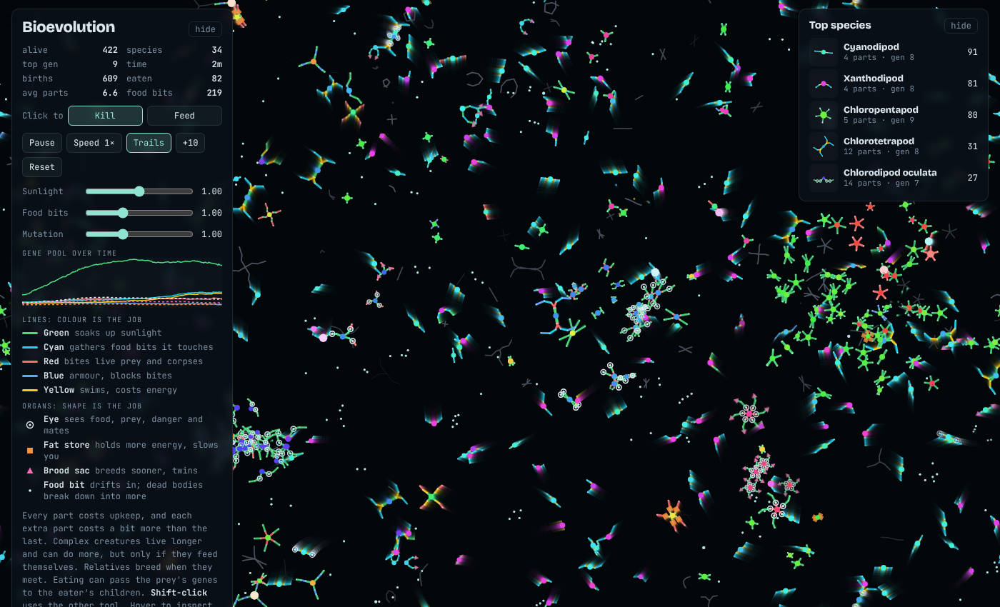
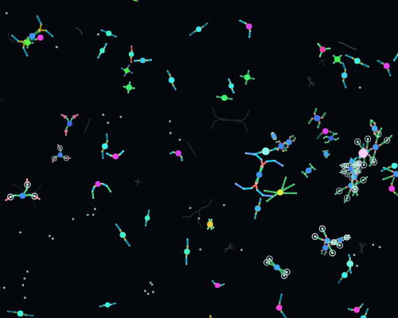
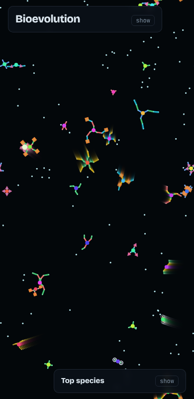

# Bioevolution

A modern take on the 1990s *Primordial Life* screensaver. It's an artificial-life petri dish that runs in the browser. Creatures are made of coloured lines with organs at their joints. They drift around, graze, hunt, breed and mutate, and over time the population evolves.

| Close-up | On a phone |
|---|---|
|  |  |

## Run it

Open `index.html` in any modern browser. There is no build step and nothing to install.

## Body parts

**Lines: the colour is the job**

| Colour | Job |
|---|---|
| Green | Makes energy from sunlight. Sunlight is shared, so a crowded dish feeds each plant less. |
| Cyan | Gathers food bits it touches. |
| Red | Bites, draining energy from live creatures it crosses (unless it hits blue) and from corpses. |
| Blue | Armour. Blocks red bites and pushes attackers away. |
| Yellow | Swims. Faster movement, at an extra energy cost. |

**Organs: the shape is the job.** Organs sit at the end of a segment.

| Shape | Job |
|---|---|
| Circle (eye) | Sight. Lets the creature steer: flee dangerous predators, hunt weaker prey, head for food bits or corpses when hungry, and find a mate. More eyes see further. |
| Square (fat store) | Holds extra energy, but adds mass, so the creature is slower. |
| Triangle (brood sac) | Lowers the energy needed to breed and gives a chance of twins. |

## Rules

- **Complexity costs.** Every part has upkeep, and upkeep grows faster than the part count, so a big complex body has to earn its keep. In return, complex creatures live longer and can do more.
- **Food.** Food bits drift into the dish in clumps. Cyan segments gather them; any creature can swallow one with its nucleus for half value. Dead bodies stay as corpses that red-biters can scavenge, then rot into more food bits.
- **Breeding.** Close relatives breed when they touch and are well fed, mixing both genomes. Very well fed creatures can also bud on their own.
- **Mutation.** Segment length, angle, colour and organ drift; segments and arms are added or removed; the nucleus colour drifts so lineages diverge.
- **You are what you eat.** A predator can keep genes from what it kills and pass them to its children.
- **Species** are named from the body plan: main colour + number of arms + main organ, e.g. *Rhodopentapod oculata* is a five-armed red biter with eyes.

## Controls

- Click to **Kill** or **Feed** (pick the tool; Shift-click uses the other one). Feeding empty water drops food bits there.
- Hover a creature to inspect it: diet, upkeep, complexity, and what it's doing right now (hunting, fleeing, grazing, courting).
- Space pauses. Speed goes up to 8×. Sliders set sunlight, food supply and mutation rate.
- The graph shows total amount of each colour (solid) and organ (dashed) in the population over time.

## Files

- `src/app.html` is the source: markup, styles and the whole simulation in one file.
- `index.html` is `src/app.html` wrapped in a standard HTML document. Regenerate it with `./build.sh` after editing the source.
- `docs/*.png` are the screenshots above. Regenerate them with `node scripts/screenshot.js` (needs Playwright) whenever the app changes.
